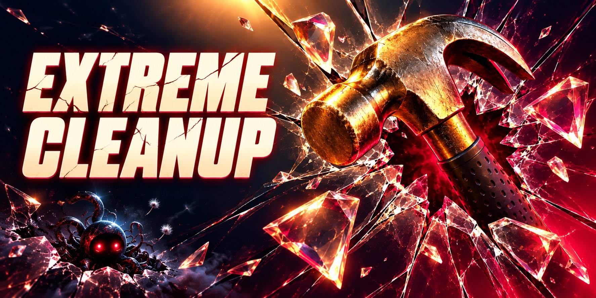

# Extreme Cleanup



A desktop toy for macOS: take a hammer or a minigun to your screen, watch the glass crack, shatter and pile up at the
bottom. Built from scratch with AI as an homage to the 2000s classic *Desktop Destroyer*.

**It never touches your files.** The app takes a snapshot of your screen and wrecks the picture. Press
Esc and your real desktop is exactly as you left it.

## Install

Requires macOS 14 or later, on Apple silicon or Intel.

> **Heads-up: macOS will warn you on first launch.** The app isn't sold through Apple or notarised by Apple, so
> macOS shows a scary dialog saying it can't check the app for malware, with a big **Move to Trash** button. Don't
> trash it: click **Done** and follow step 2. The full source is in this repo if you'd rather check it, or build
> it yourself (see [Build](#build)).
>
> **Prefer not to run unverified software?** A web version you can try in the browser is on the way.

**Scanned:** the 1.0.0 download has a [VirusTotal report](https://www.virustotal.com/gui/file/f109eed9f22053a66fc0bff9c3e94a70aef7192090832e507dc697b5595d9080).
Its SHA-256 is `f109eed9f22053a66fc0bff9c3e94a70aef7192090832e507dc697b5595d9080`; to check that your copy is the
same file, run `shasum -a 256 ExtremeCleanup-1.0.0.zip` in Terminal.

1. Download **ExtremeCleanup-<version>.zip** from [Releases](../../releases/latest) **in your browser**, unzip it
   and move **Extreme Cleanup** to Applications.
2. Open it. macOS stops it the first time:
   - **macOS 15 and later:** click **Done** on the warning. Open **System Settings › Privacy & Security**, scroll
     down to the message about Extreme Cleanup, click **Open Anyway** and confirm with your password or Touch ID.
   - **macOS 14:** right-click the app, choose **Open**, then **Open** again.
3. Allow **Screen Recording** when asked (**System Settings › Privacy & Security › Screen & System Audio
   Recording**), then quit and reopen the app.

You only do this once. Later versions are signed with the same certificate, so they open straight away and keep
the permission.

### "ExtremeCleanup can't be opened", with only an OK button?

That happens when a messenger such as Telegram saved the file for you: macOS then refuses to run it at all and
offers no **Open Anyway**. Download the zip from [Releases](../../releases/latest) in your browser instead. If you
already have the app and are comfortable with Terminal, this clears the block:

```sh
xattr -dr com.apple.quarantine /Applications/ExtremeCleanup.app
```

## Controls

The app opens with a small launcher: pick which displays to play on, which one shows the toolbelt, sound and music,
then press **Start the cleanup**. Your choices are remembered.

| Key / mouse | Action |
|---|---|
| 1 / 2 | Pick a tool: hammer / minigun |
| Click | Hammer: one hit cracks, two widen the crack, three shatter the glass |
| Hold | Minigun: every round leaves a bullet hole; seven in one spot shatter it |
| M | Music on / off |
| C | Clean up: a broom sweeps the mess away and leaves a spotless desktop |
| Esc | Back to the launcher — your real desktop is untouched |
| ⌘Q | Quit |
| D | Debug overlay (frame rate, detected icons) |

## Permissions

- **Screen Recording** — to take the snapshot it smashes. Without it you get your wallpaper instead.
- **Automation → Finder** — read-only, to find where your desktop icons are.

Newer macOS versions now and then ask you to confirm that an app may keep recording the screen. That happens to
every app that captures the screen; choose *Allow* to keep playing.

## Build

Requires macOS 14+ and the Xcode Command Line Tools.

```sh
scripts/bundle.sh                  # builds build/ExtremeCleanup.app
open build/ExtremeCleanup.app
```

Without the release signing certificate the build is signed ad-hoc: it runs the same, but macOS asks for Screen
Recording again after every rebuild.

## Credits

Inspired by *Desktop Destroyer* (freeware, 2000s). No code, art or sound from the original is used:
everything here is written from scratch, and all sounds and the music are synthesised in code.

## License

[MIT](LICENSE) © 2026 boroda studio.
